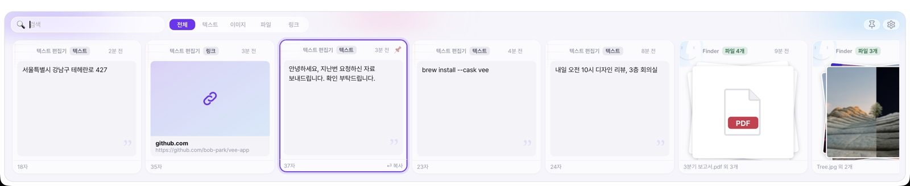
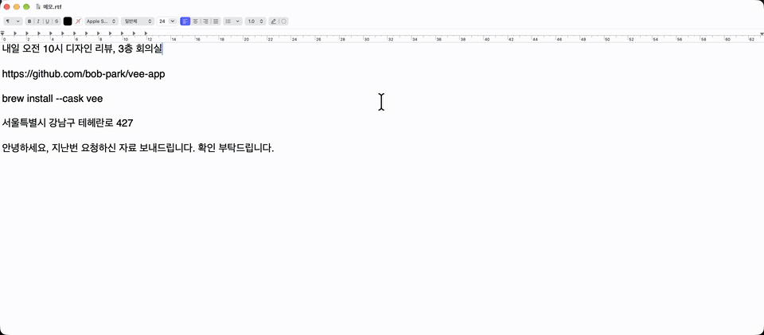
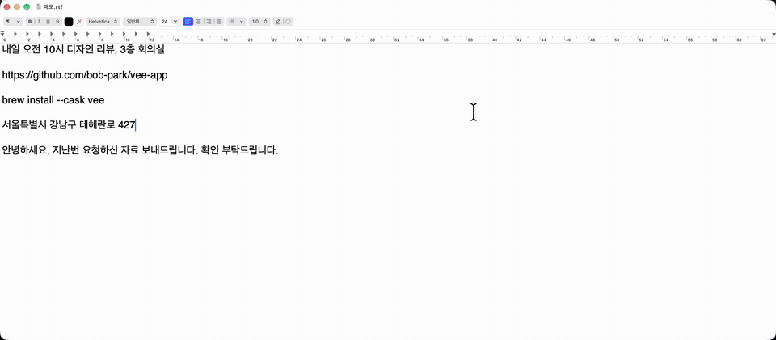
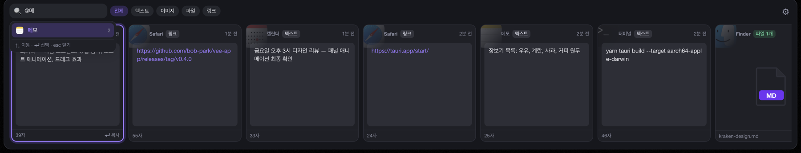
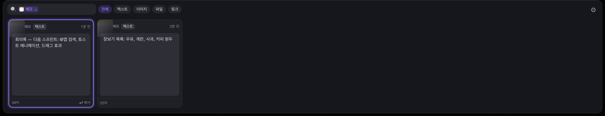
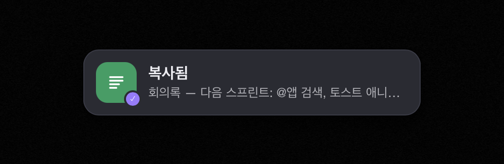

# Vee

복사한 텍스트·링크·이미지·파일을 기록해 두고, 단축키 하나로 화면 하단에 카드로 펼쳐 다시 꺼내 쓰는 클립보드 히스토리 앱입니다. macOS 앱 [Paste](https://pasteapp.io)에서 영감을 받았습니다.

- **지원 OS**: macOS (Apple Silicon), Windows 10/11 (x64)
- **기술 스택**: Tauri 2 (Rust) + React + TypeScript + Tailwind CSS (daisyUI)

## 미리보기

**패널을 띄워 둔 채 복사하면** 새 카드가 들어오고, `Enter`로 복사하면 패널이 내려가며 알림이 뜹니다.

**카드를 끌면** 카드가 커서를 따라 기울어지며 움직이고, 패널 밖으로 끌어내면 카드 모양 그대로 Finder나 다른 앱까지 따라가 놓을 수 있습니다.

| `@`로 앱 검색 | 앱 태그로 거르기 |
|---|---|
|  |  |

## 주요 기능

- **클립보드 히스토리**: 텍스트, 링크, 이미지, 파일·폴더 복사를 자동으로 기록합니다. 기본은 기간 제한 없이 보관하고, 설정에서 최근 7일/30일/90일만 남기게 할 수 있습니다(고정한 카드는 남습니다). 같은 내용을 다시 복사하면 기존 항목이 맨 앞으로 올라옵니다. 0.5초 안에 클립보드가 연달아 바뀌면 마지막 내용 하나만 기록하므로, 터미널에서 드래그로 선택할 때 중간 상태가 잔뜩 쌓이지 않습니다.
- **카드 패널**: `Cmd+Shift+V`(macOS) / `Ctrl+Shift+V`(Windows)를 누르면 마우스 커서가 있는 모니터 하단에 패널이 올라옵니다. 패널과 카드 크기는 모니터에 맞춰 화면 높이의 약 30%로 정해지며, 큰 모니터에서도 최대 360pt를 넘지 않습니다(설정에서 크기 조절을 켜면 화면 높이의 50%까지 늘릴 수 있습니다). 카드 왼쪽 위에는 복사한 앱의 아이콘이 은은한 배경으로 깔리고 앱 이름이 함께 표시되며, 이미지와 이미지 파일은 썸네일로, 그 밖의 파일은 종류별 파일 아이콘으로 보이며, 여러 파일은 겹쳐 쌓인 미리보기로 표시됩니다. 패널을 띄워 둔 채 다른 앱에서 복사하면 기존 카드가 옆으로 밀리고 새 카드가 살짝 빛나며 들어옵니다.
- **검색과 필터**: 패널이 열린 상태에서 바로 타이핑하면 검색됩니다(한글 포함). 전체 / 텍스트 / 이미지 / 파일 / 링크로 걸러 볼 수 있습니다. 검색어·앱 태그·필터는 패널을 닫았다 열어도 유지되고(앱을 다시 시작하면 초기화), 조건이 걸려 있으면 필터 옆에 나타나는 **↺ 초기화**나 `Cmd+K`(macOS) / `Ctrl+K`(Windows)로 한 번에 지웁니다.
- **앱으로 검색**: 검색창에 `@`를 입력하면 복사 기록이 있는 앱 목록이 뜹니다(많이 복사한 순). 앱을 고르면 검색창에 태그가 붙고 그 앱에서 복사한 항목만 보이며, 태그 뒤에 글자를 이어서 쓰면 그 안에서 검색합니다.
- **호버 선택**: 마우스를 카드 위로 움직이면 그 카드가 선택되고, 바로 `Enter`로 복사할 수 있습니다. 호버로 선택할 때는 목록이 스크롤되지 않으며, 키보드나 휠로 스크롤해 카드가 커서 밑으로 지나갈 때는 선택이 바뀌지 않습니다.
- **다시 복사**: 카드를 더블클릭하거나 `Enter`를 누르면 클립보드에 복사되고 "복사됨" 알림이 톡 튀어오르듯 나타나고 효과음이 납니다. 붙여넣기는 원래 앱에서 직접 하면 됩니다.
- **드래그 앤 드롭**: 카드를 끌면 카드가 커서를 따라 움직이고, 패널 밖으로 끌어내면 카드 모양 그대로 따라옵니다. 파일·이미지 카드는 Finder·데스크톱·다른 앱에 놓으면 복사되고(원본은 그대로), 이미지는 `Vee 2026-10-07 14.32.05.png`처럼 복사한 시각 이름의 PNG 파일로 놓입니다. 텍스트·링크 카드는 텍스트 편집기나 입력란에 놓으면 놓은 자리에 글자(서식 없는 텍스트, 링크는 URL)가 바로 들어갑니다. 어느 경우든 클립보드는 바뀌지 않고, 놓으면 "복사됨" 알림과 효과음이 나며 카드가 맨 앞으로 올라옵니다. 패널 안에서 놓으면 제자리로 돌아갑니다. 카드가 패널 밖으로 나가면 패널은 아래로 비켜납니다.
- **드래그 변환**: 이미지 카드나 이미지 파일 카드를 끄는 중에 변환 키(기본 macOS `Option`, Windows `Ctrl`)를 누르면 커서 위치에 포맷 선택 도넛이 열립니다. 원하는 포맷(PNG, JPG, WebP, HEIC(macOS), TIFF, GIF, BMP, PDF) 위에 놓으면 커서 밑 폴더(데스크톱, Finder/탐색기 창)에 변환한 파일이 저장됩니다. 원본은 건드리지 않고, 같은 이름이 있으면 `이름 (1).png`처럼 번호를 붙입니다. 진행 상황은 카드에, 결과는 알림으로 보이며 실패하면 카드에서 다시 시도할 수 있습니다. 키를 떼면 도넛이 닫히고 평소처럼 복사됩니다.
  - **영상 변환**: 영상 파일 카드(MP4, MOV, MKV, WEBM, AVI 등)는 MP4, WEBM, MOV, GIF, MP3, 720p MP4로 바꿀 수 있습니다. 영상 변환에는 FFmpeg가 필요하며, 설정의 변환 탭에서 **다운로드**를 누르면 GitHub에서 shaka-project의 FFmpeg 정적 빌드(GPL, Vee에 포함되지 않음)를 내려받습니다(설치 전에는 영상 포맷이 흐리게 보입니다). 카드에 진행률과 남은 시간이 보이고 도중에 취소할 수 있습니다. 화질(작게/보통/원본)도 변환 탭에서 고릅니다. MP4·MOV·720p는 기본으로 하드웨어 가속(macOS VideoToolbox, Windows NVENC/QSV/AMF)을 쓰고, 실패하면 소프트웨어로 다시 변환합니다. 지금 쓰는 인코더는 변환 탭의 하드웨어 가속 옆에 표시되고, 소프트웨어로 넘어갔으면 `NVENC → CPU`처럼 보입니다.
  - **HWP 변환**: HWP·HWPX 파일 카드는 PDF로, HWP는 HWPX로, HWPX는 HWP로 바꿀 수 있습니다. 변환 탭에서 **다운로드**를 누르면 GitHub에서 [rhwp](https://github.com/edwardkim/rhwp)를 내려받습니다(Vee에 포함되지 않음, 설치 전에는 흐리게 보입니다). Windows에서는 Microsoft Visual C++ 런타임이 필요합니다.
  - **문서 변환**: 워드 문서·텍스트·HTML(DOCX, DOC, ODT, RTF, TXT, HTML)은 PDF·DOCX·ODT·TXT·RTF·HTML로, 스프레드시트(XLSX, XLS, ODS)는 PDF·XLSX·ODS로, 프레젠테이션(PPTX, PPT, ODP)은 PDF·PPTX·ODP로 바꿉니다. 이 변환에는 사용자가 직접 설치한 [LibreOffice](https://www.libreoffice.org/)가 필요합니다(Vee가 내려받지 않으며, 없으면 흐리게 보이고 변환 탭의 버튼으로 다운로드 페이지를 엽니다).
- **트레이 상주**: 창을 닫아도 종료되지 않고 메뉴바/트레이에 남습니다. 트레이 아이콘을 클릭하면 메뉴(열기 / 설정 / 업데이트 확인 / 종료)가 열리고, "열기"를 누르면 패널이 열립니다.
- **설정**: 창 위쪽 툴바의 탭으로 나뉩니다(권한 탭은 macOS만).
  - **일반**: 테마(시스템/라이트/다크), 언어(시스템/한국어/English), 로그인 시 자동 실행, 업데이트
  - **패널**: 복사 효과음(무음·팝·딸깍·차임·방울·톡 중 선택), 개별 삭제 확인, 패널 크기 조절, 패널 크기 초기화
  - **단축키**: 패널 열기 단축키, 패널 고정 단축키, 검색 조건 초기화 단축키, 고정 카드 1·2·3 복사 단축키
  - **변환**: 드래그 변환 켜기/끄기, 변환 키, FFmpeg·rhwp 다운로드·업데이트·삭제, LibreOffice 설치 확인, 영상 기본 화질, 하드웨어 가속(사용 중인 인코더 표시)
  - **권한**(macOS): 전체 디스크 접근, Finder 창 접근
  - **기록**: 보관 기간, 기록하지 않을 앱, 저장 통계, 히스토리 전체 삭제(고정 카드 제외)
- **카드 고정**: `Cmd+P`(macOS) / `Ctrl+P`(Windows)나 카드의 📌으로 최대 3개까지 고정할 수 있습니다. 고정한 카드는 패널 왼쪽에 고정한 순서대로 따로 모여 검색·필터와 상관없이 항상 보이고, 보관 기간 정리·전체 삭제에서도 지워지지 않습니다. 패널이 열려 있을 때 `Cmd+1/2/3`(macOS) / `Ctrl+1/2/3`(Windows)을 누르면 왼쪽부터 그 고정 카드가 더블클릭한 것처럼 바로 복사됩니다(설정에서 변경 가능).
- **패널 고정**: 패널 오른쪽 위(⚙︎ 왼쪽)의 고정 버튼이나 `Cmd+Shift+P`(macOS) / `Ctrl+Shift+P`(Windows)를 누르면 다른 앱을 클릭하거나 복사·`Esc`·단축키를 눌러도 고정을 풀 때까지 패널이 떠 있습니다. 고정한 패널에는 보라색 테두리가 보이고 고정 버튼이 켜집니다. 복사하면 포커스가 직전 앱으로 돌아가 바로 붙여넣을 수 있고, "복사됨" 알림은 패널 위에 뜹니다. 고정 중 단축키를 누르면 검색이 비워지고 최신 카드가 선택된 채 패널로 포커스가 돌아옵니다. 고정 상태는 앱을 다시 실행하면 풀립니다.
- **패널 크기 조절**: 설정에서 켜면 패널 위 가장자리(가운데 손잡이)를 끌어 높이를 바꿀 수 있습니다. 아래쪽은 그대로 두고 위로 늘어나며, 카드도 비율대로 커집니다. 기본 높이부터 화면 높이의 50%까지 조절되고, 바꾼 크기는 저장되어 설정을 꺼도 유지됩니다. 설정의 "패널 크기 초기화"로 기본 크기로 되돌립니다.
- **서식 없이 복사**: `Shift+Enter` 또는 `Shift`+더블클릭으로 글꼴·링크 같은 서식을 뺀 텍스트만 복사합니다.
- **기록하지 않을 앱**: 설정에서 고른 앱에서 복사한 내용은 저장하지 않습니다. 추가할 때 그 앱의 기존 기록도 지웁니다(고정 카드 제외).
- **자동 업데이트**: GitHub Releases에서 새 버전을 확인해 백그라운드로 내려받고, 사용자가 "업데이트 후 재시작"을 누를 때 설치합니다.
- **새 소식**: 자동 업데이트로 새 버전이 설치된 뒤 처음 실행하면 그 버전의 릴리스 노트(GitHub 릴리스 본문)를 창으로 한 번 보여줍니다. 처음 설치하거나 dmg/exe로 직접 설치한 경우에는 뜨지 않습니다.

## 설치

[Releases](https://github.com/bob-park/vee-app/releases)에서 최신 버전을 내려받습니다.

| OS | 파일 | 비고 |
|---|---|---|
| macOS (Apple Silicon) | `Vee_<버전>_aarch64.dmg` | Apple 공증을 거친 앱입니다. Intel Mac은 지원하지 않습니다. 보호된 폴더(문서, 다운로드 등)의 파일을 드래그로 꺼내려면 설정의 권한 탭에서 **전체 디스크 접근**을 허용하세요. 열린 Finder 창 위에서 드래그 변환을 하려면 같은 탭에서 **Finder 창 접근**(자동화 권한)을 허용하세요. |
| Windows | `Vee_<버전>_x64-setup.exe` | 코드 서명이 없어서 첫 실행 시 SmartScreen 경고가 뜹니다. **추가 정보 → 실행**을 누르세요. |

## 사용법

| 동작 | 키 |
|---|---|
| 패널 열기/닫기 | `Cmd+Shift+V` / `Ctrl+Shift+V` (설정에서 변경 가능) |
| 카드 이동 | `←` `→`, 마우스 휠 |
| 카드 선택 | 마우스 올리기 |
| 복사 후 닫기 | `Enter`, 더블클릭 |
| 서식 없이 복사 | `Shift+Enter`, `Shift`+더블클릭 |
| 카드 고정/해제 | `Cmd+P` / `Ctrl+P`, 카드의 📌 |
| 고정 카드 바로 복사 | `Cmd+1/2/3` / `Ctrl+1/2/3` (설정에서 변경 가능) |
| 패널 고정/해제 | `Cmd+Shift+P` / `Ctrl+Shift+P` (설정에서 변경 가능), 패널 오른쪽 위 고정 버튼 |
| 설정 열기 | `Cmd+,` / `Ctrl+,` |
| 검색 | 그냥 타이핑 |
| 앱으로 거르기 | `@` + 앱 이름 → `↑` `↓`로 고르고 `Enter` (`Esc`로 취소) |
| 앱 태그 지우기 | 검색창이 비어 있을 때 `Backspace`, 또는 태그의 `×` |
| 필터 전환 | `Tab` / `Shift+Tab` |
| 검색 조건 초기화 | `Cmd+K` / `Ctrl+K` (설정에서 변경 가능), 필터 옆 ↺ 초기화 |
| 카드 꺼내기 (파일·이미지·텍스트·링크) | 카드를 끌어다 놓기 |
| 이미지 변환해서 꺼내기 | 끄는 중에 `Option` / `Ctrl` (설정에서 변경 가능) → 도넛의 포맷 위에 놓기 |
| 선택한 카드 삭제 | `Delete`, 검색창과 앱 태그가 비어 있을 때 `Backspace` (설정에서 확인 켜면 `Enter`로 확정) |
| 닫기 | `Esc`, 패널 밖 클릭 |

## 개인정보

- 모든 히스토리는 **이 컴퓨터에만** 저장됩니다(SQLite). 외부로 보내지 않으며, Vee 자신은 업데이트 확인과, 사용자가 변환 탭에서 FFmpeg·rhwp 다운로드를 누를 때만 네트워크를 씁니다. 단, HTML 파일을 LibreOffice로 변환할 때는 LibreOffice가 문서에 연결된 원격 이미지·스타일을 불러올 수 있습니다.
- 비밀번호 관리자 등에서 "민감 정보"로 표시한 복사는 저장하지 않습니다.
- 로그에는 복사한 내용이 기록되지 않습니다.

| 항목 | macOS | Windows |
|---|---|---|
| 데이터 (DB, 이미지) | `~/Library/Application Support/com.bobpark.vee/` | `%APPDATA%\com.bobpark.vee\` |
| 로그 | `~/Library/Logs/com.bobpark.vee/` | `%LOCALAPPDATA%\com.bobpark.vee\logs\` |

## 문서

- [개발 환경 구성과 빌드](docs/development.md)
- [릴리스 절차](docs/release.md)
- [에이전트용 규칙 (AGENTS.md)](AGENTS.md): 구조, 코딩 규칙, 브랜치·버전 규칙 (`docs/agents/`)
- [설계 문서](docs/superpowers/specs/2026-10-07-vee-clipboard-history-design.md)
- [v0.4.0 설계: 카드 UI · 앱 태그 검색 · 애니메이션](docs/superpowers/specs/2026-10-08-panel-animations-design.md)

## 라이선스

[MIT License](LICENSE)를 따릅니다. Copyright 2026 Bob Park
